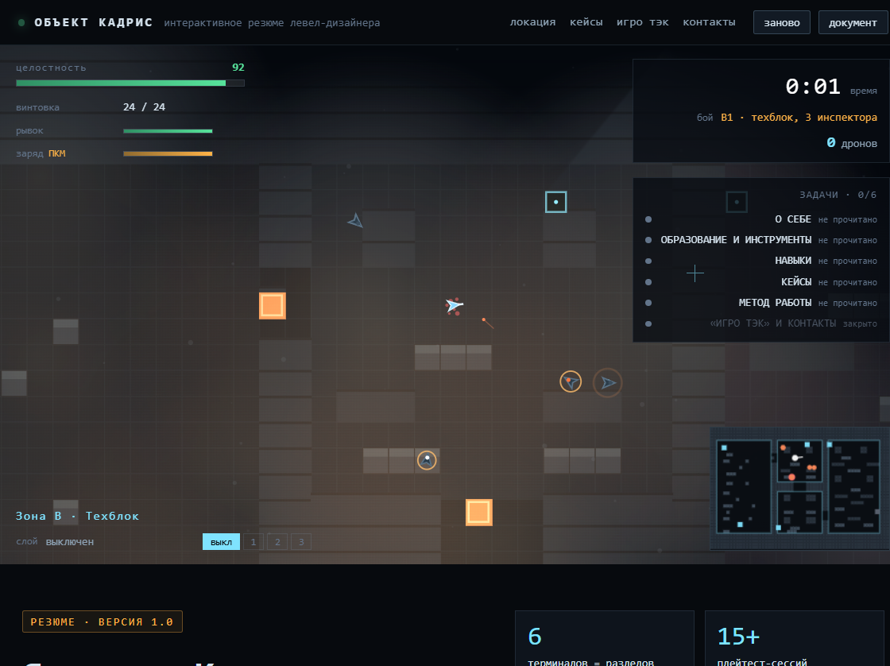
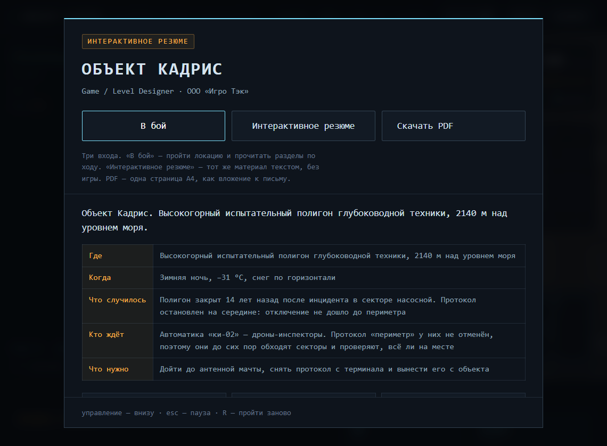
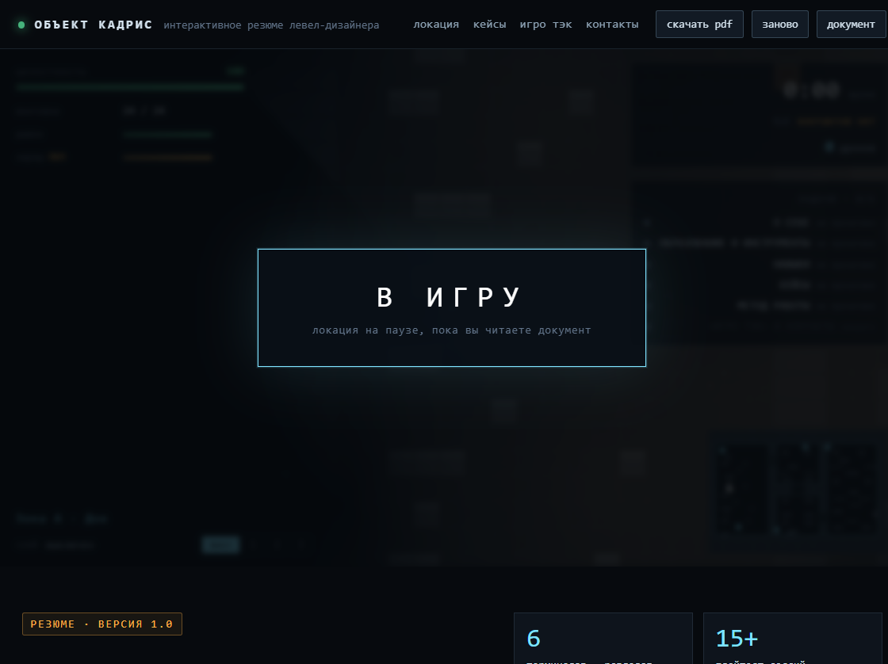
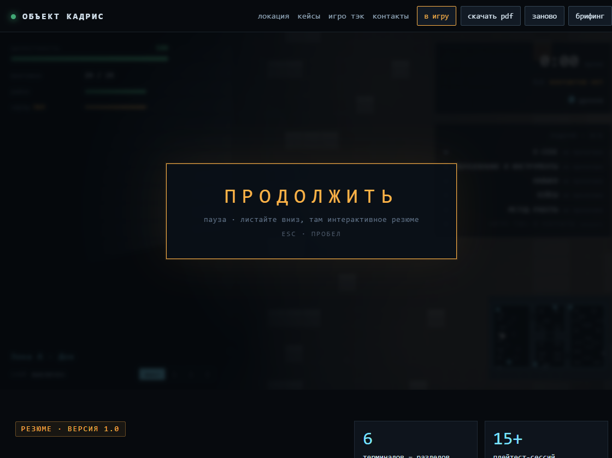
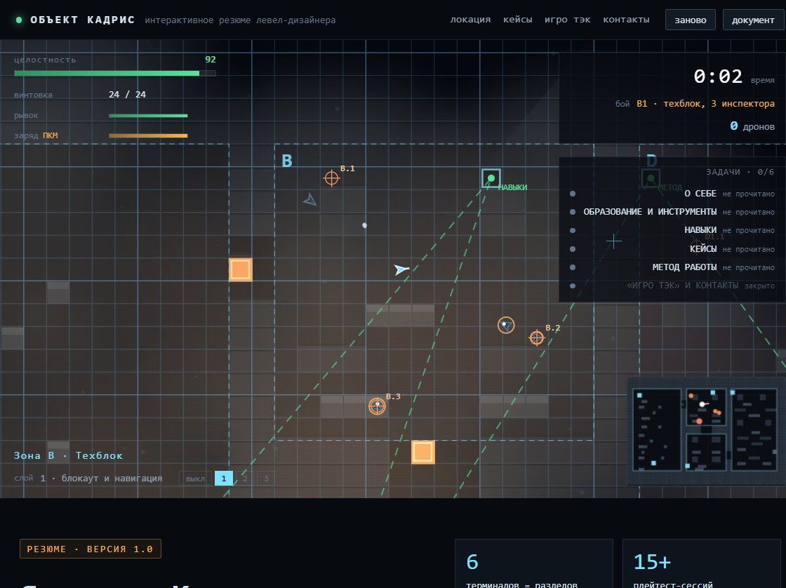
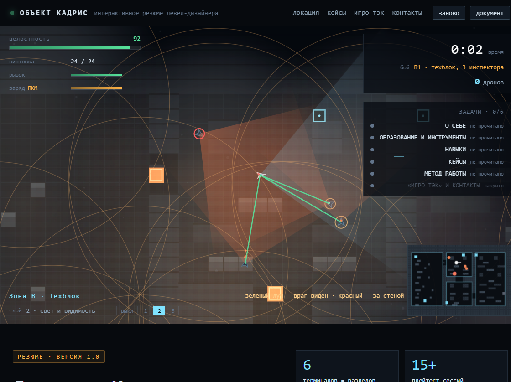
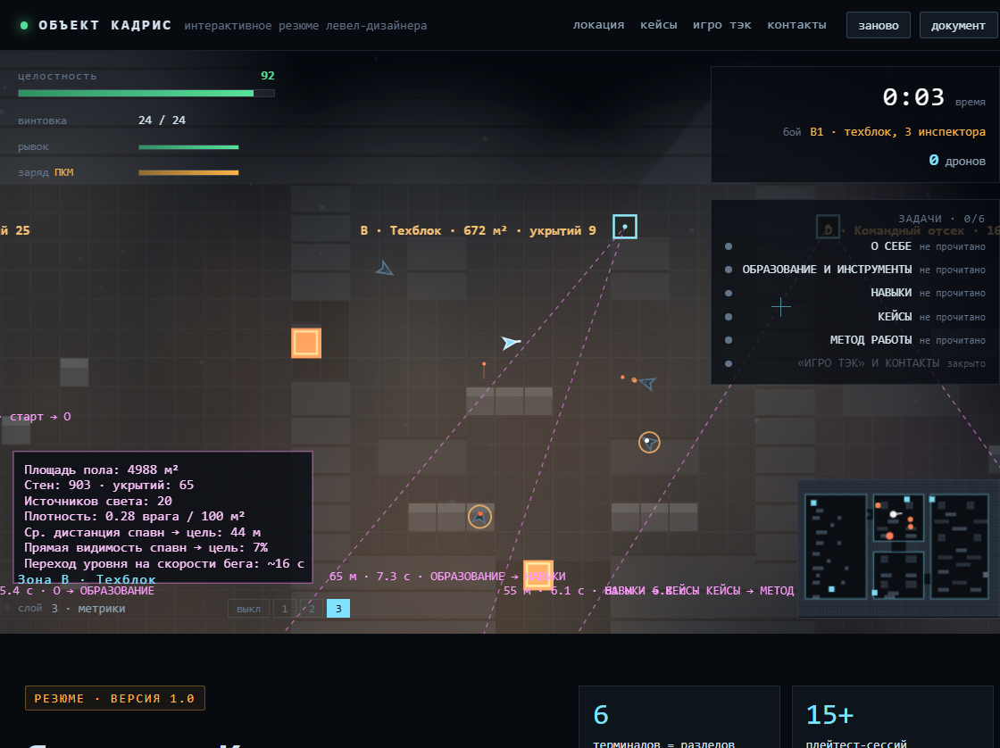
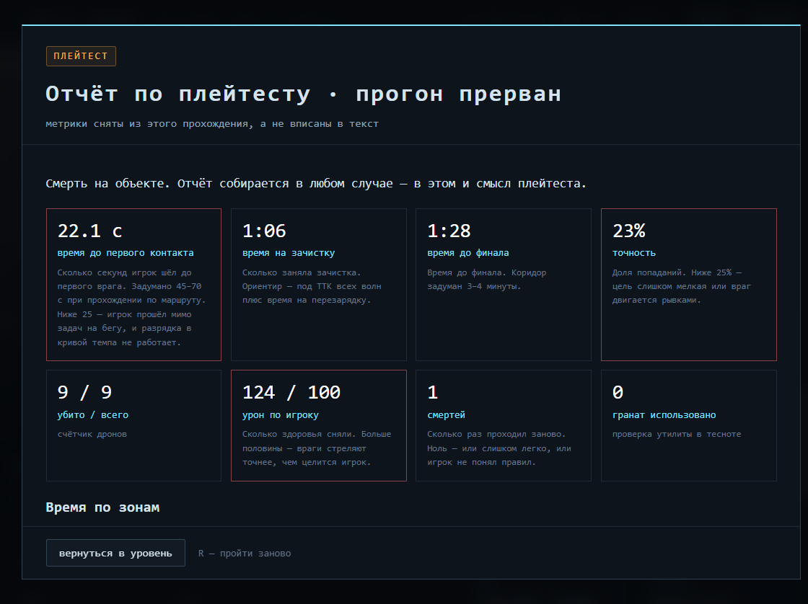
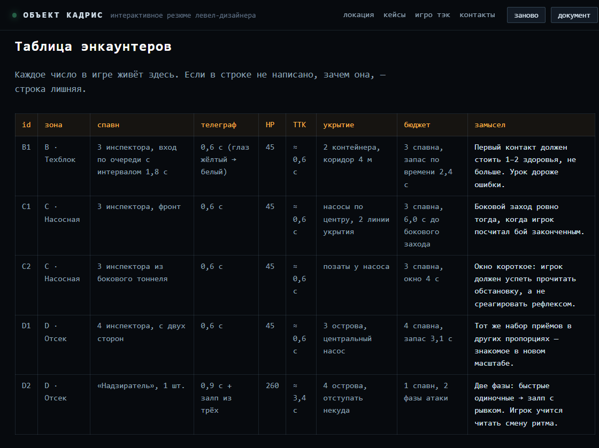
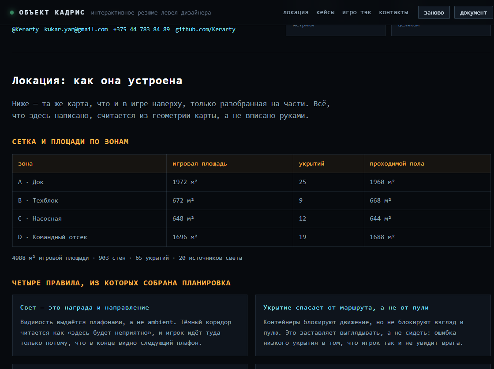

# Объект Кадрис — резюме левел-дизайнера в виде локации

Резюме на вакансию **Game / Level Designer** в «Игро Тэк». Вместо списка
достижений здесь играбельный greybox-уровень: четыре зоны, шесть волн,
элитный бой и шесть терминалов, в которых лежит всё остальное.

Логика простая: на левел-дизайнера смотрят не на текст, а на то, что он
способен показать руками. Плейтест-отчёт внизу собирается из прохождения
в браузере — цифры не вписаны, они снимаются с конкретного прогона.

**Живая версия:** https://kerarty.github.io/cv-igrotech/



## Три входа

На старте три кнопки — кому что нужно:



- **В бой** — пройти локацию и читать разделы по ходу. Полная версия.
- **Интерактивное резюме** — тот же материал текстом, без игры. Уровень при
  этом встаёт на паузу и сверху висит кнопка **В ИГРУ**: пока её не нажали,
  локация не принимает ввод. Иначе документ и игра дрались бы за клавиатуру.
- **Скачать PDF** — одна страница A4, как вложение к письму. Та же кнопка
  есть в верхней панели.



## Пауза по esc

`Esc` во время игры ставит паузу и **открывает доступ к документу** — страница
листается свободно, локация при этом стоит. Не нужно ни закрывать игру, ни
искать отдельную вкладку: хочешь проверить формулировку в разделе про
метрики — нажал `Esc`, пролистал, вернулся тем же `Esc`.

Продолжить можно тремя способами: `Esc`, пробел или кнопка **в игру** в шапке.
Плашка над уровнем подсказывает и то, и другое.



## Зачем

Обычное резюме на левел-дизайнера читается как список обязанностей:
«участвовал в проекте, делал локации». Проверить по нему ничего нельзя —
кроме одного: приложить скриншот из редактора. Скриншот показывает
результат и ничего не говорит о том, как он получен.

Здесь показан процесс. Уровень собран из карты, метрики считаются по
её геометрии, а не вписаны руками, — если передвинуть стену, цифры
в разделе «Метрики» поменяются сами.

## Что внутри

- **Локация 112 × 76 м** — док, техблок, насосная, командный отсек.
  Сетка 2 м, 903 стены, 65 укрытий, 20 источников света.
- **Шесть терминалов** — разделы резюме открываются по ходу прохождения,
  а не лежат списком. Пропустить нельзя: закрытая дверь не пускает дальше.
- **Пять волн и элитный бой.** У каждого врага есть телеграф: глаз
  загорается за 0,6 с до выстрела. Смерть всегда была предсказуемой.
- **Три слоя дизайна по клавишам 1–4** — то, что обычно видно только
  в редакторе.
- **Плейтест-отчёт** с метриками прогона, временем по зонам, графиком
  твоего темпа против задуманного и одной гипотезой на следующую итерацию.
- **Дизайн-документ под игрой**: лор, сценарий, таблица энкаунтеров,
  кривая темпа, ТЗ на свет и пропы, соответствие пунктам вакансии.
- `Ctrl+P` печатает документ в одну страницу A4 — это то, что идёт
  вложением к письму.

## Три слоя дизайна

Клавиши `1`–`3` включают слои поверх живой игры.

**1 · блокаут и навигация** — сетка 2 и 10 м, контуры зон, точки спавна,
маршрут по терминалам. Проверяет, читается ли планировка без декораций.



**2 · свет и видимость** — конусы обзора врагов, лучи видимости от игрока,
зоны плафонов. Ищет места, где враг видит игрока раньше, чем игрок видит
врага.



**3 · метрики** — площади зон, расстояния между точками с пересчётом
в секунды, плотность врагов. Это тот аргумент, который обычно и звучит
в споре о длине перехода: не «так короче», а «на этой дистанции игрок
тратит столько-то секунд».



## Плейтест-отчёт

Умрёте или дойдёте до финала — соберётся отчёт. Ниже скриншот прогона
автоматического сценария: метрики настоящие, играл скрипт, а не человек.



Что он снимает: время до первого контакта, время на зачистку, точность,
урон, смерти, время в каждой зоне и плотность времени на площадь. Плюс
график — сплошная линия задуманного темпа, пунктирная фактический.

Главная находка этого прогона: **время до первого контакта — 22 секунды**
вместо задуманных 45–70. Сценарий шёл без остановок и пропустил половину
терминалов. Разница в 2,5 раза — и это видно только потому, что цифры
снимаются, а не оцениваются.

## Дизайн-документ



Каждое число в игре живёт в таблице: у строки есть причина, иначе строка
лишняя.



Ниже таблицы — лор, сценарий по битам, кривая темпа, ТЗ на свет, пропы,
звук и приёмку, и раздел «Где закрыт каждый пункт вакансии», где каждый
пункт требований ссылается на раздел, который его закрывает. Там, где
пробел, он назван прямо: раздел «Чего у меня пока нет» написан первым.

## Управление

| | |
| --- | --- |
| `W A S D` | движение |
| мышь | прицел |
| ЛКМ | огонь |
| ПКМ | заряд-граната |
| `Пробел` | рывок |
| `Shift` | бег |
| `E` | прочитать терминал рядом |
| `1` `2` `3` | слои дизайна |
| `Q` | миникарта |
| `R` | пройти заново |
| `Esc` | пауза и доступ к документу; повторное нажатие — продолжить |

На паузе пробел и стрелки работают как обычно, кроме пробела: он
продолжает игру, а стрелки, `PageDown` и `End` листают документ.

## Запуск

Сборки нет. Достаточно открыть `index.html` двойным кликом.

Если нужен локальный сервер:

```
python -m http.server 8777
# http://localhost:8777
```

Уровень рассчитан на мышь и клавиатуру. С телефона откроется документ —
делать неудобные экранные кнопки для шутера я не стал.

## Технологии

- HTML, CSS, JavaScript — без фреймворков, сборки и единого CDN
- Canvas 2D: уровень, темнота с прожжённым светом, слои дизайна
- Ни одной внешней зависимости: у рекрутера не должен отваливаться
  интернет посреди просмотра
- `Ctrl+P` печатает документ в A4 — отдельные стили печати

## Что пришлось починить по дороге

Не ради истории, а чтобы было видно, что код прогоняли, а не собирали
в голове и не коммитили:

- `overflow: hidden` на `<body>` распространяется на вьюпорт и при снятии
  сбрасывает прокрутку — страница прыгала с середины документа наверх.
  Помогло только `overflow` на `<html>` вместе с возвратом позиции.
- Клавиши читались как `keys["w"]`, а обработчик писал `keys["KeyW"]`:
  WASD не работал вообще. Теперь читается `e.code` — работает и на кириллице.
- У врага не было поля `radius`: `undefined` в арифметике давал NaN во всей
  геометрии, и пули улетали в никуда.
- Закрытые двери не блокировали движение — гейтинг задач был только картинкой.
- Пробел на паузе вызывал `showScreen(null)`, который пересчитывает
  состояние, но не снимает флаг паузы: игра оставалась на паузе, а плашка
  не исчезала.
- Обработчик клавиш держался только за `e.code`. Он не зависит от раскладки,
  но в части окружений (удалённый рабочий стол, экранные читалки) приходит
  пустым — и игра целиком переставала отвечать. Добавлен запасной путь через
  `e.key`.

Валидатор длины строк карты в `level.js` написан первым делом: он сразу
поймал четыре кривые строки в разметке.

## Файлы

| Файл | Что в нём |
| --- | --- |
| `content.js` | **Весь текст резюме и документа.** Правится только он |
| `level.js` | Блокаут: карта, двери, спавны, волны, лучи видимости, метрики |
| `game.js` | Игрок, ИИ, оружие, темнота, отрисовка |
| `ui.js` | HUD, слои дизайна, панели, отчёт, графики |
| `main.js` | Запуск, ввод, игровой цикл, сборка документа |
| `assets/Yaroslav_Kukar_Game_Level_Designer.pdf` | Резюме на одну страницу |
| `tools/check-encoding.py` | Проверка кодировки исходников |

## Перед выкладкой

Поднять версию в трёх местах, иначе посетитель увидит старый документ:

1. `?v=` в `index.html` — у ссылки на стили и у всех пяти скриптов
2. `SIGN.changelog` в `content.js` — новая запись в начало
3. имя папки не важно, GitHub Pages кэширует файлы около десяти минут

Метка в ссылках обязательна: без неё браузер отдаёт свежую разметку
вместе со старым скриптом, и это выглядит как сломанная кнопка без текста.

## Кодировка

Файлы лежат в UTF-8. Если прогнать их через перенаправление в консоли без
явной кодировки, кириллица запишется дважды закодированной: имя в шапке
превратится в `РїСЪЬѯоап Кукар`. Проверить перед коммитом:

```
python tools/check-encoding.py
```

Скрипт ловит и двойное кодирование, и битый UTF-8, и пропавший файл.

## Чего у меня пока нет

Коммерческого опыта в геймдизайне нет, опыта работы в большой команде —
тоже, CryEngine я не трогал. Это написано первым разделом резюме, потому
что дешевле назвать пробел самому, чем выяснять его на созвоне.

## Контакты

Telegram [@Kerarty](https://t.me/Kerarty) ·
[kukar.yar@gmail.com](mailto:kukar.yar@gmail.com) ·
+375 44 783 84 89 ·
[github.com/Kerarty](https://github.com/Kerarty)